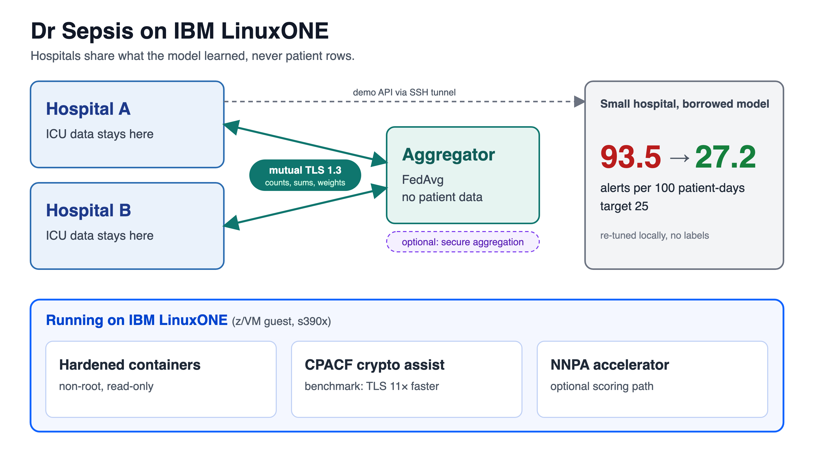
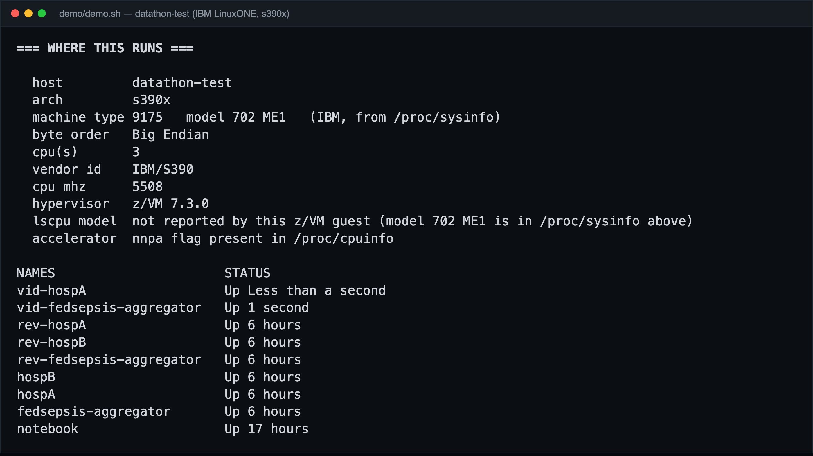
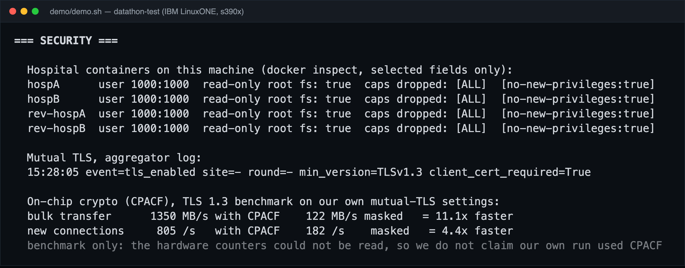
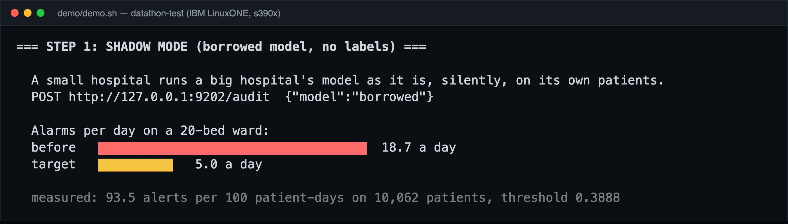
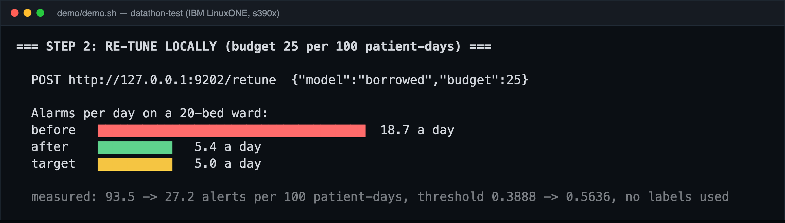
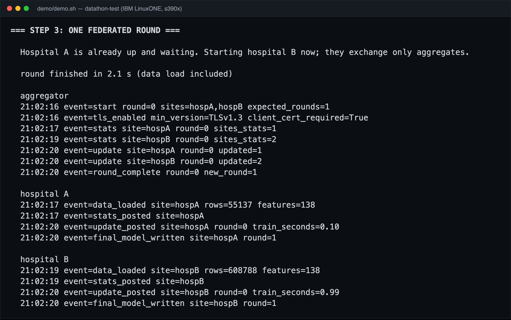
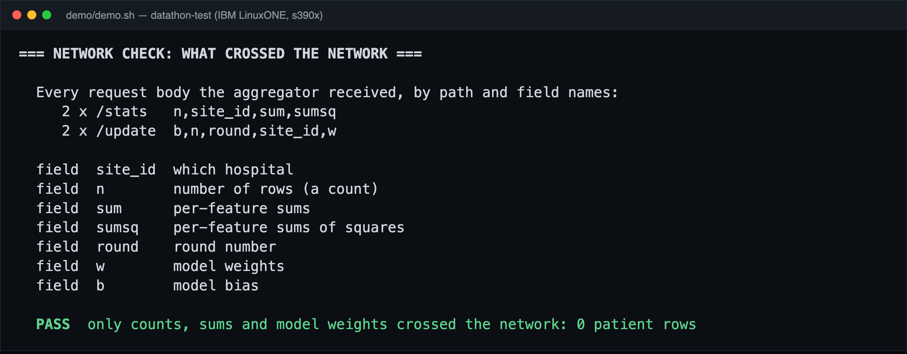
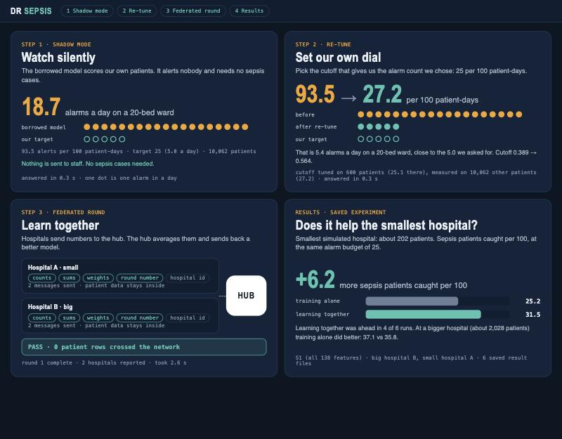

# marvel_IBM Z Datathon 2026 Project

> Team **marvel** · IBM Z Datathon 2026 · built on the LinuxONE Community Cloud

**Dr Sepsis**: a sepsis early-warning system that lets hospitals learn together without sharing a single patient row.

**Theme:** AI secured: innovation without exposure

<p align="center"></p>

## Problem

Sepsis is a time-critical emergency in intensive care, and a small hospital rarely has enough of its own data to train a good early-warning model. Pooling patient records across hospitals is not an option, and borrowing another hospital's model as it is brings a second problem: **alarm flood**.

In our experiment, a small hospital that runs a big hospital's model unchanged gets **93.5 alerts per 100 patient-days**. On a 20-bed ward that is **18.7 alarms a day**, against the budget of 5 a day (25 per 100 patient-days) that staff can act on.

## Data

- **PhysioNet/Computing in Cardiology Challenge 2019**, training sets A and B, which we treat as two hospital systems with hourly ICU records: <https://physionet.org/content/challenge-2019/1.0.0/>. Follow PhysioNet's terms.
- 138 engineered hourly features per patient-hour.
- Demo split used for the numbers below: a big hospital with 608,788 training rows, a small hospital with 55,137 training rows (a 10% subset), and 10,062 held-out patients (392,374 rows) for testing.
- **No data is in this repository.** Raw rows, exports and patient-level outputs are git-ignored; see [`data/README.md`](data/README.md).

## Solution

Dr Sepsis runs in three steps, and the first two need no labels:

1. **Shadow mode.** The small hospital runs the borrowed model silently on its own patients and measures how many alarms it would have raised: 93.5 per 100 patient-days (18.7 a day).
2. **Re-tune locally.** It picks its own alert threshold for the alarm budget it wants (25 per 100 patient-days). Result: **93.5 → 27.2** per 100 patient-days, or 5.4 alarms a day against the 5.0 target. Threshold 0.389 → 0.564, no labels used.
3. **Learn together (federated learning).** Each hospital trains on its own data and sends only counts, sums of squares and model weights to an aggregator, which averages them (FedAvg) and returns a better model. Every run checks the request bodies the aggregator received: **only `n`, `sum`, `sumsq`, `site_id`, `round`, `w` and `b` crossed the network, so 0 patient rows**.

An optional **secure aggregation** mode hides even each hospital's own update: sites add pairwise masks that cancel in the sum. In the three-site test the secure result equals plain FedAvg (maximum difference 6.9e-17).

### Does it help? (saved experiment, reported as measured)

At the same alarm budget of 25, for the smallest simulated hospital (about 202 patients), learning together catches **6.2 more sepsis patients per 100** than training alone (31.5 vs 25.2). It was ahead in 4 of 6 runs. At a bigger hospital (about 2,028 patients) training alone did better (37.1 vs 35.8). So the gain is for the smallest hospitals, which is where it matters.

## Why IBM Z / LinuxONE

Everything runs on our LinuxONE Community Cloud instance: IBM machine type 9175 (model 702 ME1), a z/VM 7.3 guest, `s390x` big-endian, 3 vCPUs, Ubuntu 24.04 with Docker.

| Capability | How we use it | Evidence |
| --- | --- | --- |
| Containerisation | One container per hospital plus an aggregator, on a private Docker network | [01](docs/screenshots/01-platform-linuxone.png), [05](docs/screenshots/05-federated-round-containers.png) |
| Security | Non-root user, read-only root file system, all capabilities dropped, no-new-privileges. Hospital-to-aggregator traffic is **mutual TLS 1.3** (client certificate required). Demo ports bound to `127.0.0.1` | [02](docs/screenshots/02-security-hardening-mtls-cpacf.png), [06](docs/screenshots/06-network-check-no-patient-rows.png) |
| On-chip crypto (CPACF) | OpenSSL uses it for our TLS. With our own mutual-TLS settings, CPACF on vs masked: bulk transfer 1,350 vs 122 MB/s (**11.1x**), new connections 805 vs 182 per second (**4.4x**) | [`HARDENING.md`](src/fedsepsis-deploy/HARDENING.md), [`evidence-hardening/cpacf_tls_bench.txt`](src/fedsepsis-deploy/evidence-hardening/cpacf_tls_bench.txt) |
| AI accelerator (NNPA) | An optional scoring path (`NNPA_SCORE=1`, off by default) runs the scoring product on the accelerator. It matches the CPU within 0.1 alerts per 100 patient-days in both demo directions | [`NNPA.md`](src/fedsepsis-deploy/NNPA.md) |
| Compute | The full 40-round federated training takes about 52 s on 3 vCPUs; one demo round takes about 2 s | [`results/tuned-40x3/`](src/fedsepsis-deploy/results/tuned-40x3/) |

**What we do not claim:** the CPACF numbers are a benchmark of the TLS stack, not a measurement of our own federated run, because the hardware counters need an admin daemon we cannot start on this VM. The NNPA path is available and verified for parity, but it is **not faster** for this small model, so we claim no speed-up. Secure Execution is not active on this VM and is not claimed.

## Screenshots (LinuxONE evidence)

Terminal images are renders of the real captured output of [`demo/demo.sh`](src/fedsepsis-deploy/demo/demo.sh), not edited. Platform, containers and compute:



Security (hardening, mutual TLS, CPACF benchmark):



Inference on LinuxONE, shadow mode and re-tune:




A federated round and the network check:




The browser demo page (replay of a saved real run) and the full [evidence board](docs/screenshots/08-evidence-board.png):



## Architecture

The diagram at the top is the slide version. The detailed one, with ports, fields and hardware notes, is [`docs/architecture/architecture.png`](docs/architecture/architecture.png) (SVG: [`architecture.svg`](docs/architecture/architecture.svg)).

## Tech stack

| Layer | Tools |
| --- | --- |
| Platform | IBM LinuxONE Community Cloud (`s390x`), Docker |
| ML | Logistic regression in NumPy (the `fedsepsis` library), FedAvg, optional PyTorch with the IBM NNPA plugin for scoring |
| Security | Mutual TLS 1.3 (OpenSSL), pairwise-mask secure aggregation (SHAKE-256), hardened containers |
| App / UI | Small Python HTTP services (standard library), a terminal demo script, a browser demo page |

## Open-source resources used

- NumPy: <https://numpy.org/>
- pandas: <https://pandas.pydata.org/>
- scikit-learn: <https://scikit-learn.org/>
- Matplotlib: <https://matplotlib.org/>
- joblib: <https://joblib.readthedocs.io/>
- PyTorch (with IBM's `torch_nnpa` plugin, in the LinuxONE Community Cloud Jupyter image): <https://pytorch.org/>
- Docker: <https://www.docker.com/>
- OpenSSL: <https://www.openssl.org/>
- PhysioNet/CinC Challenge 2019 dataset: <https://physionet.org/content/challenge-2019/1.0.0/>

## Repo layout

```
labs/               the two mandatory IBM AI/ML labs (completed before our own build)
notebooks/          exploration and model notebooks
src/fedsepsis-deploy/   the deployment: aggregator, hospital service, demo scripts, tests, evidence
data/               local data (raw data is git-ignored, see data/README.md)
models/             trained model artifacts (git-ignored)
docs/architecture/  design diagrams
docs/screenshots/   LinuxONE evidence for judging
```

Inside `src/fedsepsis-deploy/`: [`README.md`](src/fedsepsis-deploy/README.md) (how the deployment works), [`SETUP.md`](src/fedsepsis-deploy/SETUP.md) (set up from scratch), [`HARDENING.md`](src/fedsepsis-deploy/HARDENING.md), [`NNPA.md`](src/fedsepsis-deploy/NNPA.md), [`DEMO_API.md`](src/fedsepsis-deploy/DEMO_API.md), `demo/` (terminal demo and browser page), `tests/`, `video/` (scene scripts).

## Running it

**Try it without any hardware (replay of a saved real run).** Needs only Python 3:

```bash
git clone https://github.com/rajath-kris/marvel-ibm-z-datathon-2026.git
cd marvel-ibm-z-datathon-2026/src/fedsepsis-deploy/demo/pipeline
python3 serve.py --replay-only
```

Then open <http://localhost:8300/?replay=auto>. The page plays the four steps from a recording of one real run on LinuxONE (the file records its date and a SHA-256, and a changed file is refused).

**On LinuxONE** (the real services): follow [`SETUP.md`](src/fedsepsis-deploy/SETUP.md), then run the terminal demo from `src/fedsepsis-deploy`:

```bash
./demo/demo.sh
```

The patient data is not in this repository (see Data), so the live stack needs the data bundle described in `SETUP.md`.

## Team

| Name | Role |
| --- | --- |
| Adhil | Co-developer: design, build and testing |
| Bhavya | Co-developer: design, build and testing |
| Mitul | Co-developer: design, build and testing |
| Rajath | Co-developer: design, build and testing |
| Unnati | Co-developer: design, build and testing |

## Demo video

[](https://youtu.be/rPO3kQknFQg)

Watch on YouTube: <https://youtu.be/rPO3kQknFQg>
